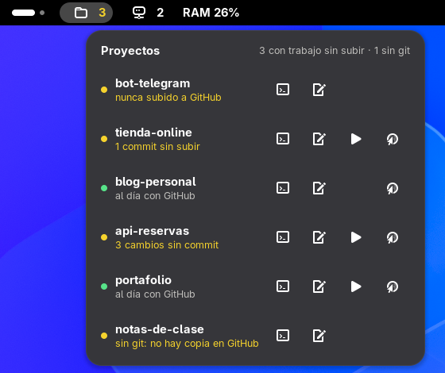

# Proyectos

Extensión de GNOME que pone tus proyectos de programación en la barra de arriba, del que tocaste más
recientemente al más viejo. Con un clic abres Claude Code, el editor, el servidor de desarrollo o
GitHub, y te avisa qué proyectos tienen trabajo que se perdería si se borra la carpeta.



## Qué hace
- **En la barra** (a la izquierda): un ícono de carpeta y, en amarillo, cuántos proyectos con git
  tienen trabajo sin subir.
- **Al hacer clic**, cada proyecto muestra:
  - **Punto verde**: al día con GitHub. **Punto amarillo**: tiene algo pendiente.
  - **Qué falta**: cambios sin commit (guardados en tu disco pero no en git), commits sin subir (en
    git pero no en GitHub), nunca subido a GitHub (el repo no tiene remoto) o sin git (la carpeta no
    tiene repositorio).
  - **Botones**, de izquierda a derecha:
    1. Terminal nueva con [Claude Code](https://claude.com/claude-code) en esa carpeta.
    2. Abrir la carpeta en el editor: el primero que tengas de VS Code, Cursor, VSCodium, Zed o
       Editor de texto.
    3. Prender el servidor de desarrollo (`run dev` con bun, pnpm, yarn o npm según el archivo de
       bloqueo del proyecto; si ese gestor no está instalado, usa bun o npm). Solo sale si el
       `package.json` tiene script `dev`.
    4. Abrir el repositorio en GitHub (en Brave, o tu navegador por defecto). Solo sale si tiene
       remoto de GitHub.
- Salen los 8 más recientes; los demás están en **Más proyectos**.
- El estado se revisa al abrir el menú y cada 2 minutos.

## Dónde busca tus proyectos
En la primera de estas carpetas que exista dentro de tu carpeta personal: `Proyectos`,
`proyectos`, `Projects`, `projects`, `Code`, `code`, `dev`, `src` o `repos`.
Cada subcarpeta es un proyecto. Para usar otra, cambia la lista `CANDIDATAS` al principio de
`extension/proyectos.js`.

"Más reciente" es la fecha más nueva entre la carpeta y su `.git/index` (que cambia con cada
`git add`, commit o cambio de rama).

## Cómo funciona
- `extension/proyectos.js` lee las carpetas y corre `git status --porcelain -b` en cada una, en
  segundo plano para no frenar GNOME. Lee el remoto de GitHub directo de `.git/config`.
- `extension/lanzar.js` abre la terminal (Ptyxis, GNOME Terminal, Consola, Kitty, Alacritty o
  WezTerm, la primera que haya), el editor y el navegador.
- Nada sale de tu computadora: no usa internet ni la API de GitHub.

## Instalar
Requisitos: GNOME Shell 48 a 51 (Wayland o X11) y `git`.
Probada en CachyOS (Arch) con GNOME 51.

```bash
git clone https://github.com/DimitriMedNov/proyectos.git
cd proyectos
./install.sh
```

No pide sudo: todo queda en tu usuario (`~/.local/share/gnome-shell/extensions/`).
Después **cierra sesión y vuelve a entrar**. En Wayland, GNOME solo carga extensiones nuevas o
actualizadas al iniciar sesión (bloquear la pantalla no basta).

Para actualizar: `git pull` y otra vez `./install.sh` (y cerrar sesión).
Para quitarla: `./install.sh --quitar`.

## Problemas comunes
- **No la veo después de instalar.** Cierra sesión y vuelve a entrar. Si sigue sin salir, revisa que
  esté activa: `gnome-extensions info proyectos@dimitrimednov.github.io` debe decir `State: ACTIVE`.
- **Ver los errores:** `journalctl --user -b -o cat /usr/bin/gnome-shell | grep -i "Proyectos"`.
- **Tu GNOME es más nuevo que 51.** Agrega tu versión a `shell-version` en
  `extension/metadata.json`, instala otra vez y prueba. Si algo falla, abre un *issue*.

## Licencia
[MIT](LICENSE). Úsala, cópiala y cámbiala como quieras.
